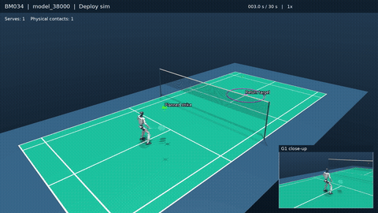

# ATHLETE — Public Project Page

Public project website for **ATHLETE: Learning Reactive Humanoid Tennis via Trajectory-Guided Motion Matching**.

- Website: https://hazintihoa.github.io/ATHLETE/
- Paper: https://arxiv.org/abs/2610.13572
- Code: https://github.com/HazinTihoa/athlete-humanoid-tennis
- Authors: Zhihao Tian, Zifan Wang, Enzheng Zhu, Xun Yang, Jialong Qin, Mengbo Wang, Junwei Liang.

## Edit and preview

- Edit `_includes/project-hero.html` for the title, authors and resource links.
- Edit `_includes/project-home.html` for the research content.
- Edit `_layouts/project.html` for the shared page shell.
- Edit `assets/hero.css` and `assets/project.css` for styling.
- Run `python3 scripts/build-homepage.py` after changes to regenerate the static preview and refresh asset versions.
- Run `python3 -m http.server 8767`, then open http://localhost:8767/.

## Publish

GitHub Pages uses the `main` branch and repository root. `index.md` loads the shared Jekyll layout and content. The generated `index.html` supports local static previews and is excluded from the Jekyll build.

This repository is a public copy of the original project website. The original `athlete.github.io` repository remains separate.

## Interactive demo

The homepage loads the MuJoCo and ONNX demo directly into a Shadow DOM component when visitors scroll near it. The full-page demo is available at `rally/`. Model inference and simulation run in the visitor's browser.

Keep asset URLs relative so images, videos, model files and scripts work under the `/ATHLETE/` GitHub Pages path. Update source files in `rally-src/` together with the generated files in `rally/` when changing the demo.

## Humanoid badminton

Using the same training pipeline, we also trained the G1 to play badminton in simulation.

